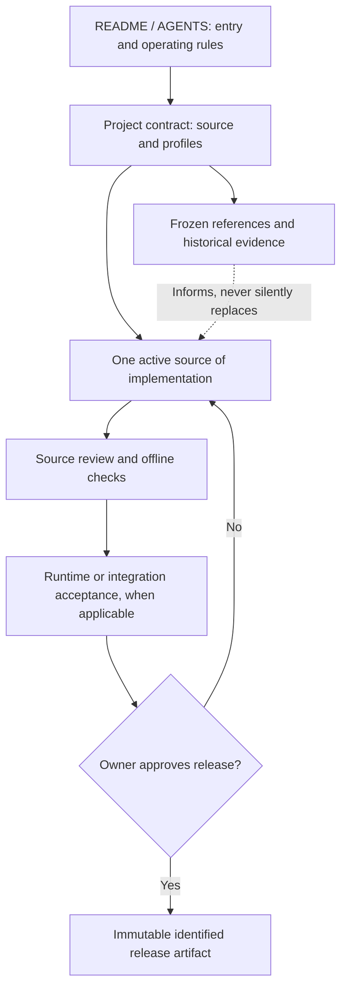

# Project Engineering Blueprint

**Platform-agnostic engineering, development, evidence, and release standard.**

This repository is both a **GitHub repository template** and the reference implementation of a lightweight, enforceable project contract. It works for games, mods, bots, scripts, applications, and services. It does **not** assume Minecraft, Arma, Godot, Python, Discord, a specific operating system, or a test server.

## Start here

For daily work, start with [AGENTS.md](AGENTS.md), the contract, roadmap, current-state handoff and active source. Read specialized policies or evidence only when the task requires them.

1. [Roadmap](docs/ROADMAP.md) and [Roadmap Governance Policy](docs/ROADMAP_POLICY.md) — current objective, completed milestones, Now/Next/Later, and decision gates.
2. [Question and idea inbox](docs/IDEA_INBOX.md) — capture relevant suggestions without treating questions as implementation authorization.
3. [Engineering standard](docs/ENGINEERING_STANDARD.md) — the mandatory principles and evidence vocabulary.
4. [Code hygiene policy](docs/CODE_HYGIENE_POLICY.md) — prevent dead code, duplication, and accumulating unreviewed complexity without unsafe cleanups.
5. [Temporary testing/debugging policy](docs/TEMPORARY_INSTRUMENTATION_POLICY.md) — tag temporary code, keep it optional, remove it when its task ends.
6. [Project contract](project-blueprint.json) — machine-readable source ownership, chosen profiles, and release state.
7. [Current development state](docs/CURRENT_DEVELOPMENT_STATE.md) — the human handoff; *this* document must describe reality.
8. [Repository policy](docs/REPOSITORY_POLICY.md) — active source, references, historical material, and branch behavior.
9. [Baseline registry](docs/BASELINE_REGISTRY.md) and [engineering evidence](docs/ENGINEERING_EVIDENCE_REGISTER.md) — preservation and proof.
10. [Release policy](docs/RELEASE_POLICY.md) — explicit promotion to a public/production artifact.
11. [Adoption guide](docs/ADOPTION_GUIDE.md) — create a project from this template or adopt it incrementally in an existing repository.

## Project map

**A commit, a test PASS, a deployed build, and an approved release are different events.** No automation may silently promote one into the next.

## Verify this template

Run `python scripts/validate_blueprint.py` to check the project contract. If the blueprint self-tests are retained, run `python tests/test_validate_blueprint.py -v` to test **only the blueprint validator**; do not use blanket test discovery as a blueprint requirement. Run application tests separately with the project's existing commands, according to the affected risk. For each release candidate, additionally run `python scripts/validate_blueprint.py --release-gate`. GitHub Actions runs these blueprint checks where enabled; they do **not** prove application behavior, target runtime, or release approval.

## Applicability

- Mandatory: source authority, lifecycle/evidence clarity, protection of frozen baselines, truthful handoffs, explicit release approval, sustainable code hygiene, and outcome-led roadmap governance.
- Optional profile guidance: [Minecraft Bedrock](profiles/minecraft-bedrock.md), [Arma](profiles/arma.md), [Godot](profiles/godot.md), [Python](profiles/python.md), [Discord](profiles/discord.md), [Generic](profiles/generic.md).
- Scaled to risk: small projects may combine inbox with roadmap and evidence with current state (with labeled sections and matching contract paths). The validator requires README/AGENTS and declared contract documents, not every optional policy filename. See [proportionality](docs/PLATFORM_PROFILES.md).

**Template note:** “Use this template” copies the files, including the blueprint's sample roadmap, ledger and evidence. On **initial creation only**, replace or discard those example project records rather than inheriting false history; keep applicable policies. See the [adoption guide](docs/ADOPTION_GUIDE.md). Later standard revisions are adopted deliberately, not synchronized automatically.

**GitHub settings note:** The repository owner must enable **Settings → General → Template repository**. Branch rules, required checks, and release permissions are separate GitHub settings; files alone do not activate them.
