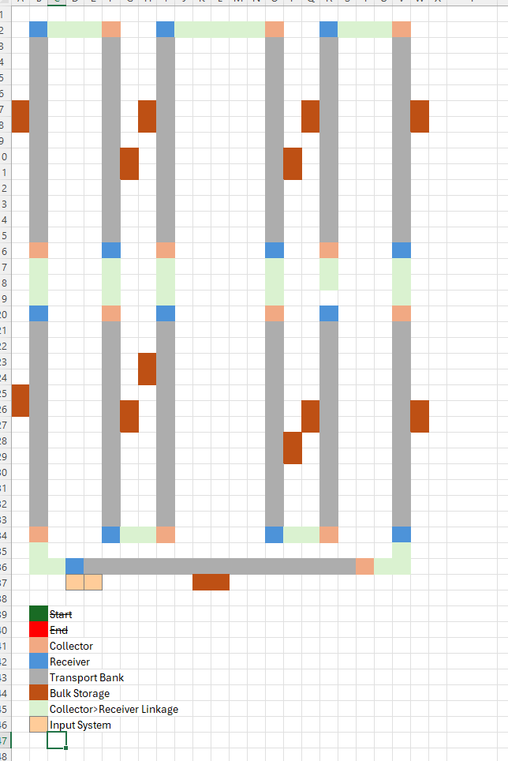
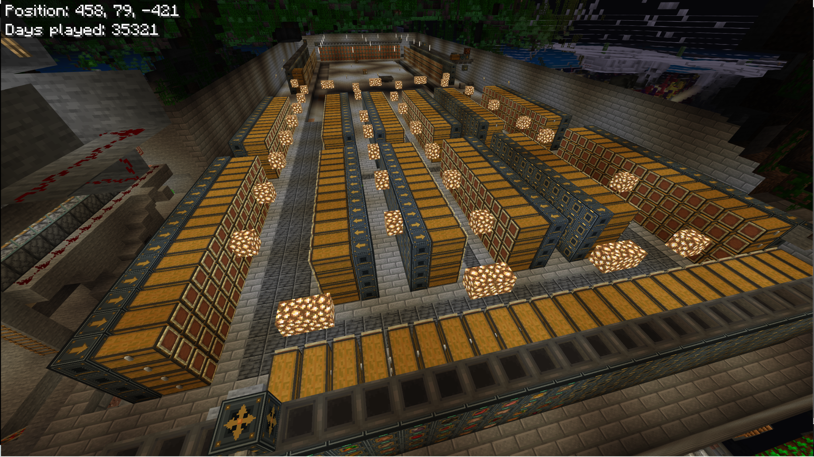

# Owner layout references — required end-to-end topology

**Classification: OWNER-SUPPLIED DESIGN REFERENCE.** The images and the owner's statements are engineering requirements/context, **not** SOURCE REVIEW, OFFLINE PASS, RUNTIME OBSERVED, or INTEGRATION ACCEPTED evidence for HartLogistics2. Added 2026-11-13.

These images were supplied by the project owner on the repository root and moved here **without modifying the PNG data**. Keep both in the design review loop; they are not optional decoration and must not be overridden by an easier single-column test rig.

## 1. Grid layout and connectivity



[Open full-size grid layout](reference-images/sorter-array.png).

The original diagram explicitly labels **Start**, **End**, **Collector**, **Receiver**, **Transport Bank**, **Bulk Storage**, **Collector–Receiver Linkage**, and **Input System**. It depicts multiple parallel banks and connections, not merely a one-source/one-pipe/one-Sorter demonstration. Preserve the depicted *connectivity and repeated-bank intent* when reviewing or implementing the routing architecture. The diagram is not a complete block-by-block coordinate or direction specification.

## 2. Intended storage-room result



[Open full-size intended storage-room result](reference-images/storage-room-array.png).

This is the owner's visual target for the integrated system. Do not treat a prototype running one Sorter or a small temporary LAB rig as a substitute for the intended multi-bank, stacked-Sorter installation.

## Owner-reported deployment scale and motivation

- The owner's original **Hart Logistics 1.4.1** startup console excerpt dated **2026-11-06 14:44:50:283** reports **1,386 Sorters, 54 Collectors, and 33 Receivers**, with **registry v2, 9 shards / 194,902 characters**. This supersedes the earlier approximate 1,400-Sorter description as the best available historical count; it is not a live inventory scan or a HartLogistics2 performance measurement. The owner describes most Sorters as following the repeated, stacked-Sorter arrangement.

  ```text
  [2026-11-06 14:44:50:283 WARN] [Scripting] [Hart Logistics 1.4.1] ready; sorters=1386, collectors=54, receivers=33, registry=v2 9 shards / 194902 chars
  ```

- **Provenance and limit:** owner-provided excerpt of a 1.4.1 script startup `ready` line; full BDS log, world snapshot, individual block placements, links, count reconciliation and runtime-independent verification are not supplied. Registry character length and shard count describe reported registry data, **not stored item quantities**. The later LAB status counts (e.g., 664 Sorters) concern a different world/configuration snapshot and must not replace this historical production-scale baseline. See [HL-E-075](ENGINEERING_EVIDENCE_REGISTER.md).
- During an earlier conversion from a copper-golem sorting system, the owner reports approximately **200,000 queued items** in the primary input Receiver; emptying them using hoppers took **nearly three weeks**. This is owner-reported operational context, **not** a measured HartLogistics2 benchmark or a validated throughput figure.
- The intended architecture therefore cannot depend on **one Sorter per network**, require manually draining existing Receivers for upgrade, or treat vanilla-hopper-rate evacuation as an acceptable high-throughput replacement. Continue supporting existing vanilla Hopper paths as a compatibility requirement.

## Engineering implications and acceptance boundaries

1. **Topology:** Support stacked Sorter columns, repeated transport banks, multiple Receivers and Collectors, existing Collector↔Receiver linkages, and the input/storage path shown by the owner, without erasing the legacy 1.4.1 contract. See [logistics design](LOGISTICS_DESIGN.md) and [ingress/egress matrix](BASELINE_INGRESS_EGRESS_MATRIX.md).
2. **Transport semantics:** Convey items into Sorters through supported Hopper and future Transporter inputs using identical Sorter filtering, priority, redstone and output rules. Adjacent ordinary containers along Transporters remain *sources*, not direct storage outputs.
3. **Queue and capacity:** Preserve queued items and metadata across migration, restart and backpressure. Work toward practical high-throughput transfer that avoids the historical prolonged Hopper-only backlog; do not claim a specific rate without testing. Bulk Storage's **200,000 items per block** is a separate design capacity target, not proof that existing Receiver backlogs have been solved.
4. **Scale and integration:** Bounded one-column or one-chunk tests can establish narrowly scoped behavior, but **do not establish acceptance of this full installation**. A complete product gate needs end-to-end representative multi-bank/stacked-column topology, large queued inventory, routing, persistence and safe recovery, with the environment and limitations recorded.
5. **No invented proof:** Neither PNG demonstrates implemented code, real-world performance, runtime acceptance or release readiness. Record owner reports as requirements, and track actual passing tests separately in the [engineering evidence register](ENGINEERING_EVIDENCE_REGISTER.md).

**Change control:** Preserve the owner-supplied original images and their provenance. Update this interpretation when the owner clarifies the layout; do not replace their target with a simplified implementation drawing.
