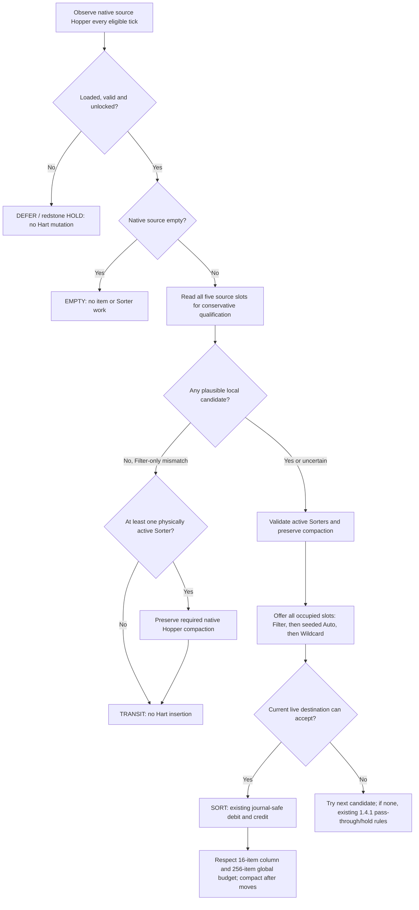

# Phase A — Transit-first qualification and conditional Hopper maintenance (P4 reassessment)

**Date:** 2026-11-16 (owner technical decision); **scope:** original 1.4.1 only. This is a plan for the next source candidate, **not** measured BDS performance or release approval. Authoritative context: [profile audit](PHASE_A_PROFILE_REVIEW_20261116.md), [owner Sorter array](../OWNER_PRODUCT_OBJECTIVE.md), [future URCE](../docs/UNIFIED_ROUTING_CUSTODY_ENGINE.md). No Bulk, Transporter, Q5 or future custody implementation is authorized in Phase A.

## Observation: transit cargo is not a local sorting job

The intended world has ~1,400 Sorters, 98% of columns 4–5 tall for player access, and very sparse filters for a given item (owner anticipates ~1–2 filtered chest destinations in the whole future governed network). This suggests most nonempty Hopper observations are **transit**, not successful local routing attempts. **This is a design hypothesis, not a measured nonmatch percentage.** Five Hopper slots may contain multiple identities. Standalone Auto and Wildcard candidates remain eligible; they cannot be treated as Filter rejects. Network remote-filter/Bulk/wildcard authority is a **future governed policy**, not a Phase A behavior change.

At P4b, `processColumn` calls `sorterAt`/power/mode for **every** registered Sorter before source compaction and before filter matching. It then reads Hopper slots and builds candidate lists. The owner identified the unnecessary order: **do not validate physical destinations just to discover that no Filter accepts an item.** Profile evidence: `sorterAt` ~8.5% inclusive, `compactSourceHopper` ~3.2% inclusive in the 19:44 active JS profile. These sampled costs overlap other work and are not speedup predictions.

## Corrected decision path

### Semantic distinction

**EMPTY** means a confirmed empty native inventory. Unloaded, unavailable and powered sources **defer or hold**; they must not be mislabeled empty.

**TRANSIT** means no *plausible* local candidate for the items seen. In 1.4.1 it leaves cargo in the native Hopper path, retaining the physical maintenance behavior of the existing engine. A powered-only or unavailable column is not a proof that network-wide routing should transit. Under future **explicit URCE governance**, missing/unknown remote capacity is not proof of Bulk fullness; HOLD/reconcile instead of silently sending to Wildcard.

**SORT** remains the original synchronous Filter → live seeded Auto → Wildcard (bottom-to-top within class) with Bypass/redstone, source item order, metadata and Q4/physical journals unchanged. No new queue, durable cache, controller, transfer writer or modified scheduling cadence.

## Implementation slices and validation decision

**P4c-1 (low-risk native call reduction):** After the existing source block has been positively checked as a Hopper, permit the lock helper to skip one duplicate Hopper `typeId` getter while **still reading live** `toggle_bit`. Unverified Hopper callers use the original guard. This has no custody effect.

**P4d-1 (first transit-first slice):** Before the all-Sorter native validation scan, perform a **read-only** slot-aware qualification over the current 1.4.1 registry, using the **existing exact `matchesFilter`** (including potion identity and enchanted-book enchantment type sets). If **any** Auto or Wildcard is registered, or an item/filter read cannot be proven safe, conservatively take the current route path. If **any** of five slots matches a registered Filter, take the current path. Only when **all** occupied slots provably miss all local Filter candidates and there are no Auto/Wildcard entries may we take a negative fast path.

**P4d-2 (necessary compaction on negative):** Even with zero candidate matches, the original engine compacts when it finds at least one physically active non-Bypass Sorter. Preserve that exact active gate: short-circuit at the first real active Sorter, then call the **existing native compaction**, and return without destination resolution. When no active Sorter exists, return without compaction. Never classify a failed native read as a proven mismatch. This **does not** omit compaction from every transit case: avoiding it would change oldest-cargo progress and vanilla Hopper pass-through.

**P4e** follows **only after real BDS reprofile** of P4c/P4d. Optimize remaining dense live destination admission if still dominant; no speculative negative-route cache or `Container.moveItem` replacement.

**Do not implement** a fixed one-of-three routing rotation now. It can defer interception while vanilla Hopper moves cargo; the current global rotating start and per-column/global move budgets remain unchanged. The source-observe/qualify/commit stages are decision gates, **not separate ticks**.

## Tests required before LAB

1. Existing baseline differential for original 1.4.1 behavior, all old 1.4.1 source tests, and pinned 2.7 API. New source-executed fast-path tests compare all five-slot patterns, mixed matching/mismatching contents, potion and enchanted-book identities, Auto/Wildcard, Bypass, redstone, stale/unloaded Sorters, metadata-preserving compaction and failure-to-prove match. Require **identical inventory states and successful transfer counts** to P4b; ensure negative Filter-only workload makes strictly fewer physical Sorter lookups.
2. Native Hopper semantics, compaction and available Q4/physical journals must remain unchanged; no post-qualification inventory state carried across ticks.
3. Existing CI Windows/Linux guarded LAB updater and deterministic packaging; update exact candidate source SHA in LAB updater when source changes, preserving previous allowlisted candidate hashes and fail-closed scope.
4. Owner LAB controlled **powered/settled, active local-match, active transit-heavy, mixed slots and blocked/backpressure** runs at identical real topology. Compare native `.mcstats` P50/P95/P99, TPS, final chest throughput, native JS profiler hotspots, journals, Q4 integrity and MR safety. Scale later to real 4–5-tall, ~1,400+ Sorter arrangement. A source test cannot certify BDS improvement.

## Pre-implementation verification result

Design preserves same-tick Hopper observation, exact 1.4.1 priority, compaction's physical-active prerequisite, redstone, native match semantics and original custody writer. **No unresolved product-policy decision is necessary for these scoped P4c-1/P4d-1 source changes.** Future governed-network route semantics and cross-tick scheduling remain deferred. Proceed with source candidate, then CI and owner LAB; **production deployment is a separate runtime acceptance gate and cannot be inferred from GitHub CI.**

## First implementation candidate — source development in progress

The owner authorized immediate source development after design revalidation. The candidate implements a **conservative negative Filter-only fast path** after the native nonempty predicate and before all-Sorter validation. It checks every live Hopper slot with existing exact `matchesFilter` semantics; any Auto, Wildcard, unknown mode, ambiguous item read or Filter match takes the old routing path. Proven transit returns only after performing the original physical-active compaction gate (if applicable). Bypass-only columns have no compaction and no destination lookup. The existing `hopperIsRedstoneLocked` general helper remains backward-compatible while positively verified source Hoppers skip its duplicate typeId getter.

**Validation conditions:** P4b source-differential inventories/transfers (including all 1,024 five-slot identity combinations), unchanged redstone/Auto/Wildcard and compaction, original 1.4.1 CI and pinned Bedrock 2.7.0 declarations, guarded LAB updater, deterministic package, then owner-authorized *native BDS* runs. Source-only test results must be reported separately from native performance. No release or production action is approved by this candidate.

## First owner LAB no-intentional-routing capture

[November 17 native idle-like capture and provenance](PHASE_A_IDLE_BASELINE_20261117.md): script P50 15.696 ms, P95 26.167 ms, P99 41.608 ms across 358 timing values; level P95 40.508 ms. This is an **idle-like condition**, not validation of transit-first routing performance or full-scale 20 TPS. The JS and TS profiler views are the same capture; native observation and Collector adjacency calls persist. The raw diagnostics do not prove the exact deployed source SHA (earlier owner updater invocation was refused), nor zero incidental transfers. Keep the source revision fixed and gather matched active transit/local-match/backpressure cases before P4e decisions.

## November 17 owner LAB active-routing audit: P4e reassessment

[The two native timing windows and two independent JS/TS profile captures](PHASE_A_ACTIVE_ROUTING_REVIEW_20261117.md) show script P95 **91.297 ms** (262 timing samples) and **77.217 ms** (252 samples), compared with **26.167 ms** in the earlier no-intentional-routing window. The separate active profiles report **356,699 / 332,329** native `Container::getSlot` calls inside `findAcceptSlot` in approximately 20 seconds apiece, about **49 getSlot probes per normal admission invocation**. Native dense admission is now the most actionable residual-cost hypothesis, while the preliminary P4d early-rejection benefit remains **unquantified** without matched P4b traffic. Do not derive full server TPS from independent level/script leaves or double-count JS/TS views. LAB deployment SHA has not yet been proven by the uploads alone.

**Revised next step:** investigate P4e within original 1.4.1's single synchronous routing pipeline. Prove a native-efficient negative/dense admission strategy with source-only differentials and exact pinned API semantics **before modifying code**. Keep all redstone/Auto/Filter/Wildcard/native item metadata, physical/Q4 journals, one-tick observation and 16/256 item budgets. No cross-tick full-chest cache, no skipped cargo opportunities, no invented Hopper/container-change event. Validate any new source candidate on the same native owner LAB workload before accepting a performance claim. The source and packaging work can proceed offline; production remains prohibited.

## November 17 P4e code-only feasibility gate

[Native-chest/Sorter responsibility feasibility report](PHASE_A_P4E_CODE_ONLY_FEASIBILITY_20261117.md) and [13 source-executed cases](tests/dense_admission_concept_feasibility_141.test.mjs) confirm that the Sorter can coordinate exact admission without a second chest ledger. The responsibility diagram is achievable, **but is not itself a reduction in dense stackable destination scans**. Live `emptySlotsCount` proves zero insertion capacity for a fully occupied destination when the incoming Auto item is nonstackable (narrow candidate shortcut), but does not rule out a compatible partial stack for ordinary stackable cargo. `find`/ `contains` do not expose spare quantity or the required insertion slot from their pinned 2.7 signatures; unsafe as blanket replacements without native runtime proof. Preserve live native chest authority, partial-before-empty priority, Auto seeds, same-tick observation and existing custody. No gameplay code or BDS state was changed for this spike.
